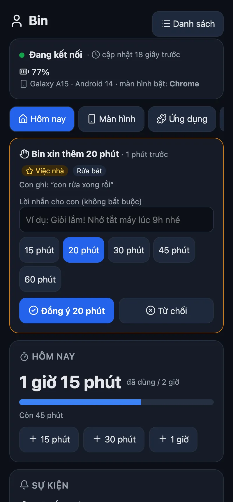
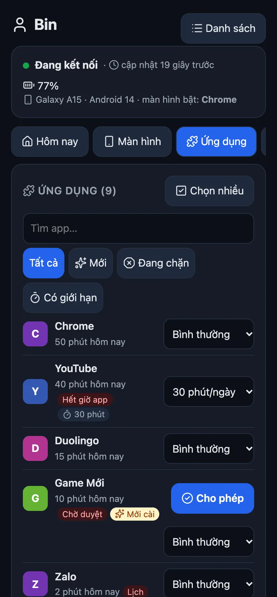
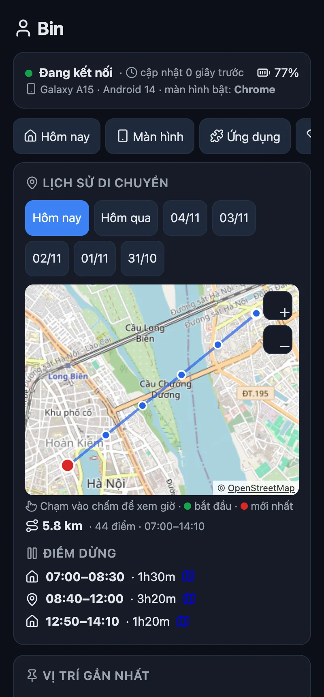
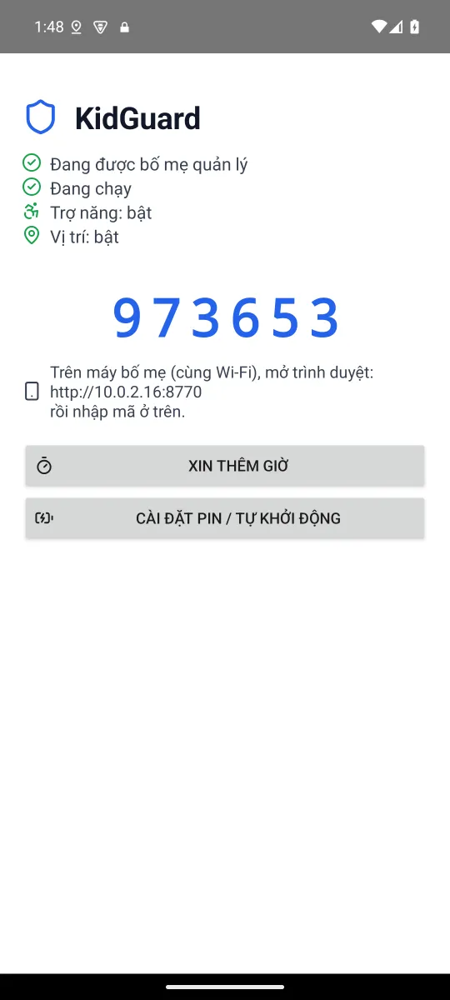

<p align="center"></p>

<h1 align="center">KidGuard</h1>

<p align="center">
  <b>Manage your child's Android phone from any browser. One APK, no account, no server you must run.</b><br>
  Android 8+ &nbsp;·&nbsp; rules run on the phone, even offline &nbsp;·&nbsp; every change undoable
</p>

<p align="center">
  <a href="https://kidguard-56k.pages.dev">Website</a> ·
  <a href="#get-it">Get it</a> ·
  <a href="#install">Install</a> ·
  <a href="#features">Features</a> ·
  <a href="#away-from-home">Away from home</a> ·
  <a href="#iphone--ipad">iPhone / iPad</a> ·
  <a href="#help">Help</a>
</p>

<p align="center">
  <a href="https://github.com/HoangTran0410/kidguard/releases/latest"></a>
  
  
  
  <a href="LICENSE"></a>
</p>

<table>
<tr>
<td align="center"><br><sub>Today: time left, requests, quick actions</sub></td>
<td align="center"><br><sub>Apps: limits, block, approve new</sub></td>
<td align="center"><br><sub>Where they went, on a map</sub></td>
<td align="center"><br><sub>On the child's phone</sub></td>
</tr>
</table>

KidGuard becomes the phone's **Device Owner**, the same Android role a company uses for work phones. That is what lets it lock apps, keep location on and stop itself from being removed, with no root. The parent page (in Vietnamese for now) is plain HTML served by the phone itself; nothing goes to a cloud unless you turn on [Away from home](#away-from-home).

## Get it

| You need | Where |
|---|---|
| The app for the child's phone | [kidguard.apk](https://github.com/HoangTran0410/kidguard/releases/latest/download/kidguard.apk) |
| QR code for a new or factory-reset phone | [kidguard.99-hoangtran.workers.dev/qr](https://kidguard.99-hoangtran.workers.dev/qr) |
| Install from a computer's browser (USB, no adb) | [kidguard.99-hoangtran.workers.dev/install](https://kidguard.99-hoangtran.workers.dev/install) |
| The parent page | the phone shows its address after setup: `http://<phone IP>:8770` |

## Install

Android only lets an app become Device Owner while the phone has **no accounts** (Google, Samsung, Xiaomi…). Remove them first, install, then sign back in: everything comes back.

| Way | Needs | Steps |
|---|---|---|
| 📱 **On the phone itself** | Android 11+, Wi-Fi | Install the APK, open KidGuard, tap **Tự cài không cần máy tính** (set up without a computer). Turn on Developer options → **Wireless debugging** → *Pair with code*, type the 6 digits into KidGuard's notification. It does the rest and turns wireless debugging off again. |
| 🔳 **Scan a QR** | a new or factory-reset phone | On the welcome screen tap 6 times on an empty spot, scan the [QR](https://kidguard.99-hoangtran.workers.dev/qr). The phone downloads KidGuard over Wi-Fi and sets it up; open it and finish the short checklist. |
| 🌐 **Browser + USB cable** | Chrome or Edge on a computer | Turn on **USB debugging**, plug in, open [/install](https://kidguard.99-hoangtran.workers.dev/install), press Connect. No adb needed. |
| ⌨️ **Command line** | macOS, Linux or Windows | `./setup.sh` (downloads adb if missing, `-y` skips questions) or `powershell -ExecutionPolicy Bypass -File setup.ps1` |

Then the child's phone shows a **6-digit code**. On the parent's phone (same Wi-Fi) open `http://<phone IP>:8770`, type the code, and in **Cài đặt** (Settings) set a **parent PIN** (without it the phone refuses to pair another browser).

Xiaomi, Oppo, Vivo, Samsung: on the child's phone tap **Cài đặt pin / tự khởi động** (battery / autostart) and let KidGuard run in the background.

## Features

| Feature | What it does |
|---|---|
| ⏱️ **Daily limit** | One number, or one per weekday. When time is up every app (except "Always allowed") locks until midnight. +15 / +30 / +60 min for today |
| 🙋 **Ask for more time** | A button on the child's phone (15 / 30 / 60 min + a reason); the parent taps Approve or Decline |
| 📦 **Per app** | Normal, N minutes a day, Block, or Always allowed. **Select many** to change them at once |
| 🆕 **New apps** | Optionally locked until a parent approves them |
| 🌙 **Bedtime and schedules** | Bedtime every day, plus windows on chosen days (school hours Mon–Fri); can cross midnight |
| ⏸️ **Pause now** | 30 min, 1 h, until 6 am |
| 👀 **See the screen** | The child's screen live in the page (Android 11+, ~3 fps). The child sees "Your parent is viewing the screen" |
| 🕹️ **Remote control** | Tap, swipe, long press, Back / Home / Recents, type into the focused field |
| 📍 **Location** | Locate now, location forced on (the child cannot turn it off), **7-day history** on an OpenStreetMap map with stops |
| 📊 **History** | Screen time for 7 days, top apps per day |
| 🛡️ **Tamper-proof** | Blocks uninstall, force stop, factory reset from Settings, Safe Mode, new users, changing the clock, airplane mode. A watchdog restarts it; accessibility turns itself back on. Optional: family DNS filter (AdGuard / Cloudflare / CleanBrowsing), block installs, block USB debugging |
| 🔒 **Commands** | Lock the screen, ring, full-screen message, restart the phone |
| ↩️ **Undo everything** | Parent page → Settings → **Gỡ quyền quản lý** (remove management): every app unlocked, every restriction lifted, then uninstall like any app |

Locked apps use Android's own `setPackagesSuspended`: the icon turns grey and opening it says the parent paused it.

<details>
<summary><b>Can the DNS filter cut the Internet?</b></summary>

It uses Android's Private DNS. If the filter's host is refused, or the network has Internet but DNS-over-TLS is blocked for 90 seconds, KidGuard falls back to normal DNS for 30 minutes and the parent page says why, so the child does not lose the Internet because of it.
</details>

## Away from home

Two options. Pick one, or use both.

| | Tailscale | Cloudflare Worker |
|---|---|---|
| Setup | paste one key, nothing to deploy | deploy a Worker (needs Node) |
| Speed | instant, the page talks to the phone directly | commands in ~20 s (~60 s screen off) |
| Parent's phone | needs the Tailscale app (Android / iPhone) | any browser |
| Child sees | a key icon in the status bar (Android always shows it for a VPN) | nothing |

### Tailscale (private network)

1. Make a free account at [tailscale.com](https://tailscale.com), then **Settings → Keys → Generate auth key**: Reusable on, Ephemeral **off** (an ephemeral device is deleted when the phone is off for a while, and its address changes).
2. In the parent page (on home Wi-Fi): **Cài đặt → Điều khiển từ xa qua Tailscale**, paste the key, optional device name, press **Bật**.
3. The child's phone downloads the official Tailscale app (SHA-256 checked), installs it silently, joins your network and hides the app. About a minute; the card then shows **Đã kết nối** and an address like `http://100.x.y.z:8770`.
4. On the parent's phone install Tailscale, log in with the same account, open that address.

The key is only accepted on home Wi-Fi and stays on the child's phone (never sent through the Worker). The child cannot turn the VPN off, change VPN settings or uninstall Tailscale; KidGuard's safe-DNS filter keeps working. **Tắt và gỡ Tailscale** (or Release) removes it all; then delete the device in the Tailscale admin console (**Machines**), since an uninstalled app cannot log itself out.

### Cloudflare Worker (relay)

The parent page works the same through a small **Cloudflare Worker** (free plan) that relays commands, state and the live screen. Frames stay in the Worker's memory only, never stored.

```bash
cd worker && npm install && npx wrangler login && npx wrangler deploy
```

In the parent page (on home Wi-Fi): **Cài đặt → Điều khiển khi khác mạng** (Settings → control away from home), paste the Worker address, press On, open the link it shows on the parent's phone. Commands reach the phone in about 20 s (about 60 s with the screen off).

## iPhone / iPad

An app like this cannot exist on iOS: Apple does not let third-party apps see the screen, control the phone or lock other apps. Use what is built in and free:

- **Screen Time + Family Sharing**: limits, downtime, app limits, adult-site filter, purchase approval, "ask for more time", managed from the parent's iPhone.
- **Find My**: the child's location.

## Help

| Need | Go to |
|---|---|
| How the parts talk to each other | [docs/protocol.md](docs/protocol.md) |
| A bug or an idea | [Issues](https://github.com/HoangTran0410/kidguard/issues) |

**Known limits**

- A factory reset from the hardware keys (recovery) still works; KidGuard is then gone and the parent page shows "disconnected".
- Live screen and remote control need Android 11+. On Android 8–10 the child can force stop KidGuard (it starts again on reboot).
- Apps that mark their screen secure (banking…) show black.
- On home Wi-Fi the page is plain HTTP (the token travels in a header): use it only on networks you trust.

**Security:** each browser pairs once with the 6-digit code on the child's phone; pairing more needs the parent PIN. The PIN is stored as a salted hash and never sent back to the page.

## For developers

```bash
./build.sh                              # build/kidguard.apk, runs the unit tests
TRUSTSTORE=/path/trust.jks ./build.sh   # behind a TLS-intercepting proxy
```

JDK 17, Android SDK 35. Parent page: `web/index.html`. Installers: `web/install.html`, `web/qr.html` (the WebUSB ADB library is bundled, rebuild with `web/vendor/build.sh`). Worker tests: `npx wrangler dev --port 8793`, then `node worker/test/relay.test.mjs`.

**Signing key:** the QR code carries the checksum of the APK's signing certificate. Every release must be signed with the same `app/signing.jks` (not in git; back it up), or phones set up by QR refuse the update.

Credits: [libadb-android](https://github.com/MuntashirAkon/libadb-android) (Apache-2.0 / GPL-3.0), [Conscrypt](https://github.com/google/conscrypt) (Apache-2.0), [Tango](https://github.com/yume-chan/ya-webadb) (MIT), [Lucide](https://lucide.dev) icons (ISC), map tiles © [OpenStreetMap](https://www.openstreetmap.org/copyright) contributors. License: [MIT](LICENSE).
