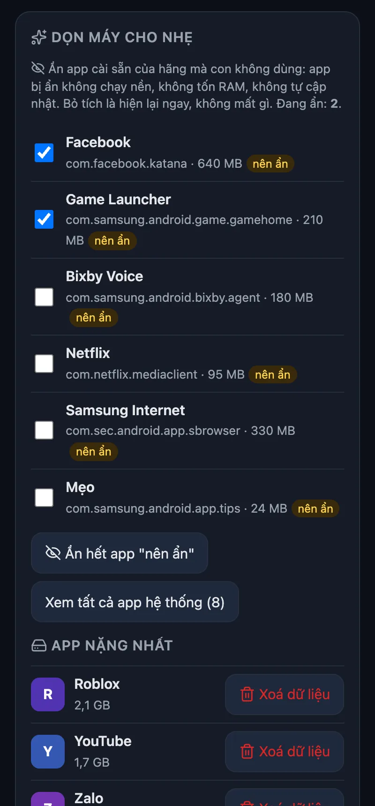

<p align="center"></p>

<h1 align="center">KidGuard</h1>

<p align="center">
  <b>Manage your child's Android phone from any browser. One APK, no account, no server you must run.</b><br>
  Android 8+ &nbsp;·&nbsp; rules run on the phone, even offline &nbsp;·&nbsp; every change undoable
</p>

<p align="center">
  <a href="https://kid-guard.pages.dev/en/">Website</a> ·
  <a href="#get-it">Get it</a> ·
  <a href="#install">Install</a> ·
  <a href="#features">Features</a> ·
  <a href="#away-from-home">Away from home</a> ·
  <a href="#iphone--ipad">iPhone / iPad</a> ·
  <a href="#help">Help</a>
</p>

<p align="center">
  <a href="https://github.com/HoangTran0410/kidguard/releases/latest"></a>
  
  
  
  <a href="LICENSE"></a>
</p>

<table>
<tr>
<td align="center"><br><sub>Today: time left, requests, quick actions</sub></td>
<td align="center"><br><sub>Apps: limits, block, approve new</sub></td>
<td align="center"><br><sub>Clean up: hide OEM apps, heaviest apps</sub></td>
<td align="center"><br><sub>Where they went, on a map</sub></td>
<td align="center"><br><sub>On the child's phone</sub></td>
</tr>
</table>

KidGuard becomes the phone's **Device Owner**, the same Android role a company uses for work phones. That is what lets it lock apps, keep location on and stop itself from being removed, with no root. The parent page (English or Vietnamese) is plain HTML served by the phone itself; nothing goes to a cloud unless you turn on [Away from home](#away-from-home).

> **Also by the author:** [TV Remote](https://github.com/HoangTran0410/tv-remote) controls an Android TV / TV box from your phone or any browser: remote, the TV's picture, kids' time limits and bedtime, ad-free home screen. No cloud, no sign-up. [tvremote.pages.dev](https://tvremote.pages.dev/?lang=en)

## Get it

| You need | Where |
|---|---|
| The app for the child's phone | [kidguard.apk](https://github.com/HoangTran0410/kidguard/releases/latest/download/kidguard.apk) |
| QR code for a new or factory-reset phone | [kidguard.99-hoangtran.workers.dev/qr](https://kidguard.99-hoangtran.workers.dev/qr) |
| Install from a computer's browser (USB, no adb) | [kidguard.99-hoangtran.workers.dev/install](https://kidguard.99-hoangtran.workers.dev/install) |
| The parent page | the phone shows its address after setup: `http://<phone IP>:8770` |
| The parent app (Android, optional) | [kidguard-parent.apk](https://github.com/HoangTran0410/kidguard/releases/latest/download/kidguard-parent.apk) |
| Just the kid launcher, no parental control (any phone, < 1 MB) | [kidguard-home.apk](https://github.com/HoangTran0410/kidguard/releases/latest/download/kidguard-home.apk) |

## Install

Android only lets an app become Device Owner while the phone has **no accounts** (Google, Samsung, Xiaomi…). Remove them first, install, then sign back in: everything comes back.

| Way | Needs | Steps |
|---|---|---|
| 📱 **On the phone itself** | Android 11+, Wi-Fi | Install the APK, open KidGuard, tap **Cài đầy đủ không cần máy tính (Android 11+)** (full setup without a computer). Turn on Developer options → **Wireless debugging** → *Pair with code*, type the 6 digits into KidGuard's notification. It does the rest and turns wireless debugging off again. |
| 🔳 **Scan a QR** | a new or factory-reset phone, stock-like Android (Pixel, Samsung, Nokia…). Some skins drop the 6-tap screen (e.g. Oppo / Realme ColorOS on Android 8–9): use the USB way | On the welcome screen tap 6 times on an empty spot, scan the [QR](https://kidguard.99-hoangtran.workers.dev/qr). The phone downloads KidGuard over Wi-Fi and sets it up; open it and finish the short checklist. |
| 🌐 **Browser + USB cable** | Chrome or Edge on a computer | Turn on **USB debugging**, plug in, open [/install](https://kidguard.99-hoangtran.workers.dev/install), press Connect. No adb needed. |
| ⌨️ **Command line** | macOS, Linux or Windows | `scripts/setup.sh` (downloads adb if missing, `-y` skips questions) or `powershell -ExecutionPolicy Bypass -File scripts\setup.ps1` |
| 🟡 **Basic mode** (no Device Owner) | any Android 8+, nothing else. For old phones with no QR screen and no computer / cable | Install the APK, open KidGuard, tap **Cài nhanh không cần máy tính** and turn on each item of the list (device admin, accessibility, usage access, location, battery). Accounts can stay. |

**Basic mode is weaker.** Blocked apps are closed back to the home screen instead of greyed out, and KidGuard leaves the
screens that would uninstall or turn it off. Not available: family DNS, blocking app installs / USB debugging, locking
airplane mode / location / clock, reboot, Tailscale. A child who boots into **Safe Mode** or finds another way to turn
accessibility off stops the blocking (the parent page shows a red warning and the parent app notifies). Use Device Owner
when you can; a basic phone can be switched later with any of the ways above.

Then the child's phone shows a **6-digit code** and a **QR code**. On the parent's phone (same Wi-Fi) scan the QR with the camera (it opens the page with the code filled in), or open `http://<phone IP>:8770` and type the code, and in **Cài đặt** (Settings) set a **parent PIN** (without it the phone refuses to pair another browser).

**Parent app (Android, optional).** The browser is enough, but the app adds notifications (SOS, time requests, accessibility
turned off) and shows the last data when the child's phone is offline. Install [kidguard-parent.apk](https://github.com/HoangTran0410/kidguard/releases/latest/download/kidguard-parent.apk) on the
parent's phone, open it, tap **Thêm máy của con** (add the child's phone), type the address shown on the child's phone and then
the 6-digit code (away from home: paste the Worker link from the child's Settings). iPhone: use the browser ([below](#iphone--ipad)).

Xiaomi, Oppo, Vivo, Samsung: on the child's phone tap **Cài đặt pin / tự khởi động** (battery / autostart) and let KidGuard run in the background.

## Features

| Feature | What it does |
|---|---|
| ⏱️ **Daily limit** | One number, or one per weekday. When time is up every app (except "Always allowed") locks until midnight. +15 / +30 / +60 min for today |
| 🪶 **Lighter phone** ("Dọn máy") | Hide the maker's preinstalled apps the child doesn't use (they stop running and updating; untick to bring back), see the heaviest apps, clear an app's data. Hiding and clearing need Device Owner. No fake "RAM cleaner" |
| 🔄 **Updates itself** | Once a day the child's phone checks GitHub releases, downloads the new APK and checks its SHA-256. Device Owner installs it silently; basic mode shows the child an **Cập nhật KidGuard** (update) button. Off / "update now": parent page, **Cài đặt**. The parent app notifies when its own update is out |
| 🙋 **Ask for more time** | A button on the child's phone (15 / 30 / 60 min + a reason); the parent taps Approve or Decline |
| 🧹 **Chores** | The parent lists chores ("Wash the dishes +20 min"); the child picks one when asking for time. The parent approves, optionally with a note the child sees |
| 🗂️ **App groups** | Put apps in a group ("Games", "Social") with one shared daily limit, and/or hours when they may be used ("YouTube only 19:00–20:00": a group of one app) |
| 🔑 **Unlock code (Google Authenticator)** | Works with no network on either phone: the parent reads 6 digits from Google Authenticator, the child types them and gets 15–120 min free of limits (fully blocked apps stay blocked). Each code works once; the parent gets an event |
| 🌐 **Languages** | English and Vietnamese in the parent page and both apps, with a language picker in each (no PIN needed on the child phone). Adding a language is one dictionary on the page plus one `values-xx` folder in the apps. |
| ⚠️ **Heads-up before locking** | The child gets a notification 5 min and 1 min before the limit, bedtime or a schedule locks the phone |
| 🧒 **Luật của con** | The child can see their own rules: time left, bedtime, schedules, allowed apps, zones, and whether location, screen view and listening are on. Plus a log of what the parents changed |
| 📦 **Per app** | Normal, N minutes a day, Block, or Always allowed. **Select many** to change them at once |
| 🆕 **New apps** | Optionally locked until a parent approves them |
| 🌙 **Bedtime and schedules** | Bedtime every day, plus windows on chosen days (school hours Mon–Fri); can cross midnight |
| ⏸️ **Pause now** | 30 min, 1 h, until 6 am |
| 👀 **See the screen** | The child's screen live in the page (Android 11+, ~3 fps). The child sees "Your parent is viewing the screen" |
| 🆘 **SOS** | A red button on the child's phone: the parent page shows a banner with the time and a fresh location; the parent app notifies in seconds through the Worker + [Firebase push](#instant-sos-notifications-optional), else within ~15 min |
| 👂 **Listen around** | The parent hears the child's microphone, one way, at most 10 min at a time. **Home Wi-Fi or Tailscale only** (not through the Worker). The child is always told: a beep, a notification "Your parent is listening" and Android's mic dot; this cannot be turned off |
| 🕹️ **Remote control** | Tap, swipe, long press, Back / Home / Recents, type into the focused field |
| 📍 **Location** | Locate now, location forced on (the child cannot turn it off), **7-day history** on an OpenStreetMap map with stops |
| 🗺️ **Zones** | Places like Home or School with a radius: the parent is told when the child arrives or leaves |
| 🔔 **Alerts** | Arrived / left a zone, battery at 15 %, a new app installed, the clock changed |
| 📊 **History** | Screen time for 7 days, top apps per day; **weekly report** per kid (total, daily average, top apps, versus the week before) |
| 📋 **Rule templates** | School day, Weekend, Summer holiday, Exams, or save your own; apply to one kid or several at once |
| 👨‍👩‍👧 **All kids at once** | With 2+ kids, **Tổng quan** (overview): a card per kid (online, battery, phone, app in use, time used / limit, requests, SOS), every kid's latest location on one map, 7 days of screen time side by side. Parent app, or the Worker page with several relay kids |
| 🛡️ **Tamper-proof** | Blocks uninstall, force stop, factory reset from Settings, Safe Mode, new users, changing the clock, airplane mode. A watchdog restarts it; accessibility turns itself back on. Optional: family DNS filter (AdGuard / Cloudflare / CleanBrowsing), block installs, block USB debugging |
| 🔒 **Commands** | Lock the screen, ring, full-screen message, restart the phone |
| ↩️ **Undo everything** | Parent page → Settings → **Gỡ quyền quản lý** (remove management): every app unlocked, every restriction lifted, then uninstall like any app |

Locked apps use Android's own `setPackagesSuspended`: the icon turns grey and opening it says the parent paused it.

<details>
<summary><b>Can the DNS filter cut the Internet?</b></summary>

It uses Android's Private DNS. If the filter's host is refused, or the network has Internet but DNS-over-TLS is blocked for 90 seconds, KidGuard falls back to normal DNS for 30 minutes and the parent page says why, so the child does not lose the Internet because of it.
</details>

## Away from home

At home the parent page talks to the kid's phone over Wi-Fi. When the kid is at school or out there are 3 free ways (use one or several). **The shared relay is already on after pairing**, so the page opens from anywhere even if you do nothing.

- Just alerts and quick taps (extra time, lock, location): **Telegram bot**.
- Everything like at home (live screen, listen around): **Tailscale**.
- Only a browser: the **relay** (on by default; host your own if you don't want data on the author's Cloudflare).

| | Telegram bot | Tailscale | Relay (shared, on by default) | Your own relay |
|---|---|---|---|---|
| Setup | ~2 min: make a bot, paste its token | ~5 min, once: Tailscale app on the parent's phone + paste one key | none | ~3 min on a computer: run one script (needs Node.js) |
| Used with | the Telegram app (buttons) | the parent page | the parent page, any browser | the parent page, any browser |
| Speed | ~1 s | instant (direct connection) | usually a few seconds (live socket); fallback poll ~20 s, ~60 s with the screen off | same |
| Screen / listen | screenshot, 10-60 s recording | live screen, live listen | live screen, no listen | live screen, no listen |
| SOS / more-time alerts | instant in Telegram | page / parent app | page / parent app | page / parent app |
| Your data goes through | Telegram's servers | nobody (end-to-end encrypted, peer to peer) | the author's Cloudflare account | only your own Cloudflare account |
| Needs | internet on the kid's phone; one bot per kid | Device Owner (not basic mode) | nothing | nothing |
| Cost / limits | free | free (Personal plan: 6 users, unlimited devices) | free, quota shared by everyone: can run out for the day | free (100,000 requests/day; one kid's phone uses ~4,300) |
| Kid sees | nothing (a notice while recording) | a key icon in the status bar (Android shows it for every VPN) | nothing | nothing |

### Tailscale (most complete)

1. On the parent's phone install **Tailscale** and sign in (Google / Apple / Microsoft account: this also makes your free Tailscale account).
2. Open [login.tailscale.com/admin/settings/keys](https://login.tailscale.com/admin/settings/keys) → **Generate access token** → **Generate** → copy it. (An auth key also works, but then you must do step 4 by hand.)
3. In the parent page (on home Wi-Fi): **Cài đặt → Điều khiển từ xa qua Tailscale**, paste the key, press **Bật**. The kid's phone downloads the official Tailscale app (SHA-256 checked), installs it silently, joins your network and hides the app (about a minute); the card then shows **Đã kết nối** and an address like `http://100.x.y.z:8770`.
4. With the access token the kid's phone makes its own one-off key and turns off Tailscale's 180-day key expiry for itself, then forgets the token (never stored); the card shows **không hết hạn**. With an auth key instead: in [login.tailscale.com/admin/machines](https://login.tailscale.com/admin/machines), on the kid's phone row → **⋯ → Disable key expiry** (the page reminds you), or Tailscale signs the phone out after 180 days.
5. On the parent's phone open that address (with Tailscale on). Several kids: add each one's address from the same page (**Thêm máy của con**).

The key is only accepted on home Wi-Fi and stays on the child's phone (never sent through the Worker). The child cannot turn the VPN off, change VPN settings or uninstall Tailscale; KidGuard's safe-DNS filter keeps working. **Tắt và gỡ Tailscale** (or Release) removes it all; then delete the device in the Tailscale admin console (**Machines**), since an uninstalled app cannot log itself out.

### Your own relay (advanced)

A small **Cloudflare Worker** in your own free Cloudflare account relays commands, state and the live screen. Frames stay in the Worker's memory only, never stored. On a computer with [Node.js](https://nodejs.org) 18+:

```bash
git clone https://github.com/HoangTran0410/kidguard && cd kidguard
scripts/relay.sh          # Windows: powershell -ExecutionPolicy Bypass -File scripts\relay.ps1
```

It installs the tools, opens the Cloudflare login in your browser (make a free account there if needed), deploys, and prints your relay address (`https://kidguard.<you>.workers.dev`). Run it again to update; `--delete` (`-Delete`) removes it.

Then in the parent page (on home Wi-Fi): **Cài đặt → relay Cloudflare Worker**, paste the address, press **Bật**, open the link it shows on the parent's phone (or add it in the parent app).

### Shared relay

Same as above with the author's relay: paste `https://kidguard.99-hoangtran.workers.dev` instead. Nothing to install, but your kid's state passes through someone else's Cloudflare account and the free daily quota is shared by everyone using it. Fine to try; switch to Tailscale or your own relay for daily use.

### Instant SOS notifications (optional)

Easier: the [Telegram bot](#telegram-bot-optional-easiest) delivers SOS and more-time requests at once with no build. The steps below are for the parent app.

Without this the parent app checks every ~15 minutes. With it, SOS and "more time" requests from a kid connected through the Worker arrive in seconds (Firebase Cloud Messaging, free). Only an id, a time and the minutes go through Google; names, notes and locations do not.

1. [console.firebase.google.com](https://console.firebase.google.com): add a project, then **Add app → Android**, package `dev.kidguard.parent`. Download `google-services.json` into `android/parent/` and build (`scripts/build.sh`).
2. **Project settings → Service accounts → Generate new private key**, then: `cd relay && npx wrangler secret put FCM_SA < /path/key.json && npx wrangler deploy`. Delete the key file afterwards.
3. Open the parent app once: it registers itself with every kid that uses the Worker. The parent's phone needs Google Play services.

### Telegram bot (optional, easiest)

The child's phone runs your family's own Telegram bot: status, extra time, pause, lock, location, screenshot, block apps, files, all with buttons; SOS, "more time" requests (Allow / No buttons) and wrong-PIN photos arrive by themselves. No Tailscale or relay needed. **One bot per child.**

1. On the parent's phone open [@BotFather](https://t.me/BotFather) in Telegram, tap **Start**, send `/newbot`, then a name (`Bin's home`) and a username ending in `bot` (`binshome_kidguard_bot`).
2. Copy the token BotFather sends (`123456789:AAH…`; tap it, or copy the whole message).
3. Parent page → **Settings → Telegram** → paste → **Connect**.
4. Tap **Open Telegram and link** (or scan the QR) → **Start** in the bot. Add up to 5 people with **Other code**.

In the bot: **📋 Menu** for buttons, `/help` for commands, `/lang` for English / Tiếng Việt. Release, unpair and clear data are not possible over Telegram. Messages go through Telegram's servers; the token stays on the child's phone. Details: [docs/protocol.md](docs/protocol.md) "Telegram bot on the child phone".

## iPhone / iPad

An app like this cannot exist on iOS: Apple does not let third-party apps see the screen, control the phone or lock other apps. Use what is built in and free:

- **Screen Time + Family Sharing**: limits, downtime, app limits, adult-site filter, purchase approval, "ask for more time", managed from the parent's iPhone.
- **Find My**: the child's location.

## Help

| Need | Go to |
|---|---|
| How the parts talk to each other | [docs/protocol.md](docs/protocol.md) |
| A bug or an idea | [Issues](https://github.com/HoangTran0410/kidguard/issues) |

**"App blocked to protect your device" (Google Play Protect)?** Play Protect blocks apps installed from a browser
or file manager when they use accessibility (basic mode needs it). On the child's phone: Play Store → your avatar →
**Play Protect** → ⚙ → turn off *Scan apps with Play Protect*, install and set up KidGuard, then turn it back on. QR
setup is not affected (the phone downloads the app itself).

**Known limits**

- **PIN forgotten:** any browser or parent app that is still paired can set a new PIN in Settings (a rules save accepts a new PIN without the old one). Without one: if an Authenticator was set up, its current 6-digit code opens "Bố mẹ quản lý trên máy này" on the child's phone, and the same Settings page sets a new PIN. If the PIN was never set, holding "Parent lost access?" on the child's screen reopens pairing after 24 h (the parent is told). PIN forgotten and every paired device and the Authenticator lost: no way back in the app (factory reset or an adb reinstall only); keep the PIN and set up the Authenticator.
- A factory reset from the hardware keys (recovery) still works; KidGuard is then gone and the parent page shows "disconnected".
- Live screen and remote control need Android 11+. On Android 8–10 the child can force stop KidGuard (it starts again on reboot).
- Apps that mark their screen secure (banking…) show black.
- On home Wi-Fi the page is plain HTTP (the token travels in a header): use it only on networks you trust.

**Privacy:** what is stored where and how to remove it all: [PRIVACY.md](PRIVACY.md).

**Security:** each browser pairs once with the 6-digit code on the child's phone; pairing more needs the parent PIN. The PIN is stored as a salted hash and never sent back to the page.

## For developers

```bash
scripts/build.sh                              # build/kidguard.apk + build/kidguard-parent.apk, runs the unit tests
TRUSTSTORE=/path/trust.jks scripts/build.sh   # behind a TLS-intercepting proxy
```

Layout: `android/` (Gradle: `app/` child, `parent/` parent app), `ui/` (pages shared by both apps and the Worker), `relay/`, `website/`, `docs/`, `scripts/`.

JDK 17, Android SDK 35. Parent page: `ui/index.html` + `ui/assets/` (CSS and plain scripts, no build step). Installers: `ui/install.html`, `ui/qr.html` (the WebUSB ADB library is bundled, rebuild with `ui/vendor/build.sh`). Tests: `cd android && ./gradlew testKidDebugUnitTest :parent:testDebugUnitTest`, `cd relay && npm ci && npm test` (starts `wrangler dev` itself). CI runs both on every push (`.github/workflows/ci.yml`, no signing key there).

**Signing key:** the QR code carries the checksum of the APK's signing certificate. Every release must be signed with the same `android/app/signing.jks` (not in git; back it up), or phones set up by QR refuse the update.

Credits: [libadb-android](https://github.com/MuntashirAkon/libadb-android) (Apache-2.0 / GPL-3.0), [Conscrypt](https://github.com/google/conscrypt) (Apache-2.0), [Tango](https://github.com/yume-chan/ya-webadb) (MIT), [Lucide](https://lucide.dev) icons (ISC), map tiles © [OpenStreetMap](https://www.openstreetmap.org/copyright) contributors. License: [MIT](LICENSE).
