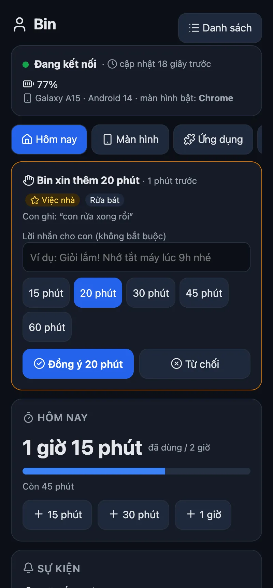
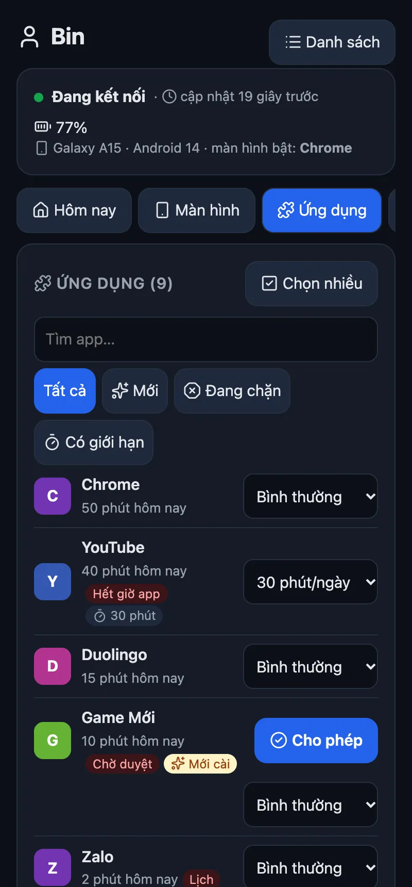
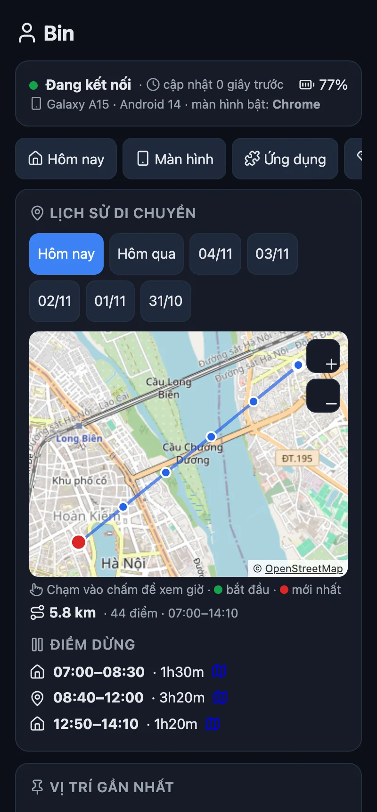
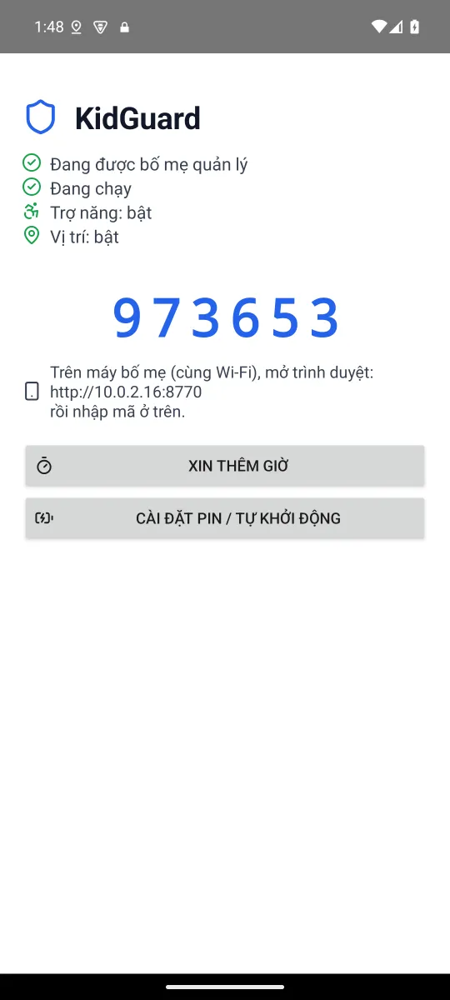

<p align="center"></p>

<h1 align="center">KidGuard</h1>

<p align="center">
  <b>Quản lý điện thoại Android của con từ trình duyệt bất kỳ. Một APK, không tài khoản, không bắt buộc máy chủ.</b><br>
  Android 8+ &nbsp;·&nbsp; luật chạy ngay trên máy con, mất mạng vẫn chạy &nbsp;·&nbsp; gỡ lại được hết
</p>

<p align="center">
  <a href="#tải-về">Tải về</a> ·
  <a href="#cài">Cài</a> ·
  <a href="#làm-được-gì">Làm được gì</a> ·
  <a href="#khi-khác-mạng">Khi khác mạng</a> ·
  <a href="#iphone--ipad">iPhone / iPad</a> ·
  <a href="#trợ-giúp">Trợ giúp</a> ·
  <a href="README.md">English</a>
</p>

<p align="center">
  <a href="https://github.com/HoangTran0410/kidguard/releases/latest"></a>
  
  
  
  <a href="LICENSE"></a>
</p>

<table>
<tr>
<td align="center"><br><sub>Hôm nay: giờ còn lại, con xin giờ, lệnh nhanh</sub></td>
<td align="center"><br><sub>Ứng dụng: giới hạn, chặn, duyệt app mới</sub></td>
<td align="center"><br><sub>Con đã đi đâu, trên bản đồ</sub></td>
<td align="center"><br><sub>Trên máy của con</sub></td>
</tr>
</table>

KidGuard làm **Device Owner** của máy (vai trò Android dành cho máy công ty), nhờ đó khoá được app, giữ vị trí luôn bật, không bị gỡ, không cần root. Trang của bố mẹ do chính máy con phục vụ; không gửi gì lên mây trừ khi bật [Khi khác mạng](#khi-khác-mạng).

## Tải về

| Cần | Ở đâu |
|---|---|
| App cho máy con | [kidguard.apk](https://github.com/HoangTran0410/kidguard/releases/latest/download/kidguard.apk) |
| Mã QR cho máy mới / vừa khôi phục cài đặt gốc | [kidguard.99-hoangtran.workers.dev/qr](https://kidguard.99-hoangtran.workers.dev/qr) |
| Cài từ trình duyệt máy tính (cáp USB, không cần adb) | [kidguard.99-hoangtran.workers.dev/install](https://kidguard.99-hoangtran.workers.dev/install) |
| Trang của bố mẹ | máy con hiện địa chỉ sau khi cài: `http://<IP máy con>:8770` |

## Cài

Android chỉ cho đặt Device Owner khi máy **không có tài khoản** (Google, Samsung, Xiaomi…). Xoá tài khoản, cài xong đăng nhập lại: mọi thứ quay về.

| Cách | Cần | Làm |
|---|---|---|
| 📱 **Máy tự cài** | Android 11+, Wi-Fi | Cài APK, mở KidGuard, bấm **Tự cài không cần máy tính**. Bật Tuỳ chọn nhà phát triển → **Gỡ lỗi không dây** → *Ghép nối bằng mã*, gõ 6 số vào thông báo của KidGuard. App tự làm phần còn lại rồi tắt Gỡ lỗi không dây. |
| 🔳 **Quét QR** | máy mới / vừa khôi phục cài đặt gốc | Ở màn hình chào mừng chạm 6 lần vào chỗ trống, quét [mã QR](https://kidguard.99-hoangtran.workers.dev/qr). Máy tự tải KidGuard qua Wi-Fi; mở app làm nốt danh sách ngắn. |
| 🌐 **Trình duyệt + cáp USB** | Chrome / Edge trên máy tính | Bật **Gỡ lỗi USB**, cắm cáp, mở [/install](https://kidguard.99-hoangtran.workers.dev/install), bấm Kết nối. Không cần adb. |
| ⌨️ **Dòng lệnh** | macOS, Linux, Windows | `./setup.sh` (tự tải adb nếu thiếu, `-y` bỏ câu hỏi) hoặc `powershell -ExecutionPolicy Bypass -File setup.ps1` |

Sau đó máy con hiện **mã 6 số**. Điện thoại bố mẹ (cùng Wi-Fi) mở `http://<IP máy con>:8770`, nhập mã, rồi vào **Cài đặt** đặt **PIN của bố mẹ** (chưa có PIN thì máy con không cho ghép thêm trình duyệt).

Xiaomi, Oppo, Vivo, Samsung: trên máy con bấm **Cài đặt pin / tự khởi động** và cho KidGuard chạy nền.

## Làm được gì

| Tính năng | Làm gì |
|---|---|
| ⏱️ **Giới hạn mỗi ngày** | Một số chung hoặc riêng từng thứ. Hết giờ: mọi app (trừ "Luôn cho phép") khoá tới 0h. +15 / +30 / +60 phút cho hôm nay |
| 🙋 **Con xin thêm giờ** | Nút trên máy con (15 / 30 / 60 phút + lý do), bố mẹ bấm Đồng ý / Từ chối |
| 📦 **Theo từng app** | Bình thường / N phút mỗi ngày / Chặn / Luôn cho phép. **Chọn nhiều** để làm hàng loạt |
| 🆕 **App mới cài** | Tuỳ chọn: khoá tới khi bố mẹ duyệt |
| 🌙 **Giờ ngủ, lịch** | Giờ ngủ hằng ngày + khung giờ theo thứ (giờ học T2–T6), qua nửa đêm được |
| ⏸️ **Tạm dừng ngay** | 30 phút, 1 giờ, tới 6h sáng |
| 👀 **Xem màn hình** | Màn hình máy con trực tiếp (Android 11+, ~3 hình/giây). Con thấy thông báo "Bố mẹ đang xem màn hình" |
| 🕹️ **Điều khiển từ xa** | Chạm, vuốt, nhấn giữ, Quay lại / Home / Đa nhiệm, gõ chữ vào ô đang chọn |
| 📍 **Vị trí** | Lấy ngay, vị trí luôn bật (con không tắt được), **lịch sử 7 ngày** trên bản đồ OpenStreetMap kèm điểm dừng |
| 📊 **Lịch sử** | Giờ dùng 7 ngày, top app mỗi ngày |
| 🛡️ **Chống lách** | Chặn gỡ app, Force stop, đặt lại máy trong Cài đặt, Safe Mode, tạo người dùng, đổi giờ, chế độ máy bay. Watchdog tự dậy lại, Trợ năng tự bật lại. Tuỳ chọn: DNS lọc web (AdGuard / Cloudflare / CleanBrowsing), chặn cài app, chặn gỡ lỗi USB |
| 🔒 **Lệnh** | Khoá màn hình, đổ chuông, nhắn tin toàn màn hình, khởi động lại máy |
| ↩️ **Gỡ được hết** | Trang bố mẹ → Cài đặt → **Gỡ quyền quản lý**: mở lại mọi app, bỏ mọi hạn chế, rồi gỡ app như thường |

App bị khoá dùng `setPackagesSuspended` của Android: icon xám, bấm vào hiện "bố mẹ đang tạm khoá".

<details>
<summary><b>DNS lọc web có làm mất mạng không?</b></summary>

Dùng DNS riêng (Private DNS) của Android. Nếu máy chủ lọc bị từ chối, hoặc mạng có Internet nhưng chặn DNS-over-TLS quá 90 giây, KidGuard tạm về DNS thường 30 phút và trang bố mẹ báo lý do, nên con không bị mất mạng vì nó.
</details>

## Khi khác mạng

Cùng trang bố mẹ, đi qua một **Cloudflare Worker** nhỏ (gói miễn phí) chuyển lệnh, trạng thái và màn hình trực tiếp. Ảnh màn hình chỉ nằm trong bộ nhớ Worker, không lưu.

```bash
cd worker && npm install && npx wrangler login && npx wrangler deploy
```

Trên trang bố mẹ (ở nhà, cùng Wi-Fi): **Cài đặt → Điều khiển khi khác mạng**, dán địa chỉ Worker, bấm Bật, mở link hiện ra trên điện thoại bố mẹ. Lệnh tới máy con trong ~20 giây (màn hình tắt: ~60 giây).

## iPhone / iPad

Không làm được app kiểu này trên iOS: Apple không cho app bên thứ ba xem màn hình, điều khiển máy hay khoá app khác. Dùng đồ có sẵn, miễn phí:

- **Thời gian sử dụng + Chia sẻ trong gia đình**: giới hạn giờ, giờ nghỉ, giới hạn app, chặn web người lớn, duyệt mua app, xin thêm giờ, quản lý từ iPhone của bố mẹ.
- **Tìm (Find My)**: vị trí của con.

## Trợ giúp

| Cần | Xem |
|---|---|
| Các phần nói chuyện với nhau thế nào | [docs/protocol.md](docs/protocol.md) |
| Báo lỗi, góp ý | [Issues](https://github.com/HoangTran0410/kidguard/issues) |

**Giới hạn đã biết**

- Đặt lại máy bằng phím cứng (recovery) vẫn làm được; KidGuard mất, trang bố mẹ báo "mất kết nối".
- Xem màn hình / điều khiển cần Android 11+. Android 8–10: con có thể Force stop (tự chạy lại khi khởi động máy).
- App có cờ bảo mật (ngân hàng…) hiện màn hình đen.
- Ở nhà trang là HTTP thường (token trong header): chỉ dùng trong mạng tin cậy.

**Bảo mật:** mỗi trình duyệt ghép một lần bằng mã 6 số trên máy con; ghép thêm cần PIN bố mẹ. PIN lưu dạng hash có muối, không bao giờ gửi lại trang.

## Cho lập trình viên

```bash
./build.sh                              # build/kidguard.apk, chạy cả unit test
TRUSTSTORE=/path/trust.jks ./build.sh   # sau proxy chặn TLS
```

JDK 17, Android SDK 35. Trang bố mẹ: `web/index.html`. Trang cài: `web/install.html`, `web/qr.html` (thư viện ADB WebUSB đóng gói sẵn, build lại bằng `web/vendor/build.sh`). Test Worker: `npx wrangler dev --port 8793` rồi `node worker/test/relay.test.mjs`.

**Khoá ký:** mã QR chứa checksum chứng chỉ ký APK. Mọi bản phát hành phải ký bằng đúng `app/signing.jks` (không có trong git, nhớ backup), nếu không máy cài bằng QR sẽ từ chối cập nhật.

Ghi công: [libadb-android](https://github.com/MuntashirAkon/libadb-android) (Apache-2.0 / GPL-3.0), [Conscrypt](https://github.com/google/conscrypt) (Apache-2.0), [Tango](https://github.com/yume-chan/ya-webadb) (MIT), icon [Lucide](https://lucide.dev) (ISC), bản đồ © [OpenStreetMap](https://www.openstreetmap.org/copyright). Giấy phép: [MIT](LICENSE).
